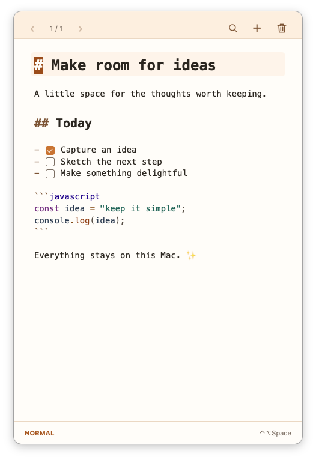
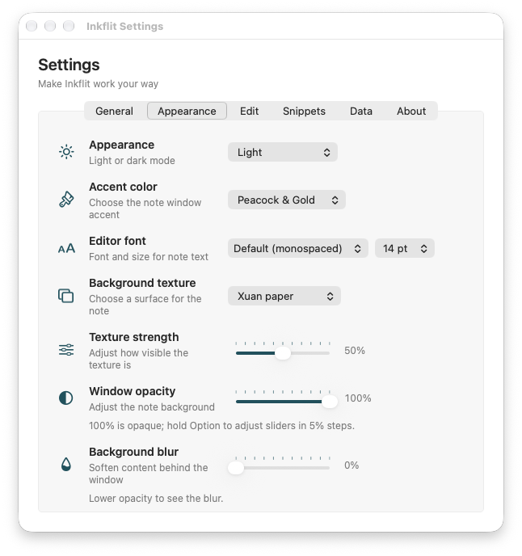

<p align="center"></p>

<h1 align="center">Inkflit</h1>

<p align="center"><strong>残しておきたいアイデアのための小さな場所。</strong><br />Markdown · Vim · Local-first · macOS</p>

<p align="center"><a href="README.md">English</a> · <a href="README.zh-Hans.md">简体中文</a> · <a href="README.zh-Hant.md">繁體中文</a> · 日本語<br />
<a href="https://inkflit.phpz.org/">公式サイト</a> · <a href="https://github.com/dofy/Inkflit">GitHub</a> · <a href="https://github.com/dofy/Inkflit/issues">Issues</a></p>

<p align="center">
  
  
  
  
  
</p>

Inkflit はローカル優先の macOS 用フローティングメモアプリです。複数のノート、Markdown、Vim 編集、コードの構文ハイライト、機能ブロック、自動保存に対応します。 初回起動時、システム言語に合わせて7つのガイドノートを作成します。設定の「ガイドノートを再作成」は、現在のアプリ言語で既存ノートの前にガイドを追加し、ようこそページを開きます。

<p align="center"></p>

<p align="center"></p>


## ビルドと起動

macOS 13 以降、Xcode Command Line Tools、Node.js、npm が必要です。

```sh
npm ci
npm run build
open build/Inkflit.app
```

`npm test` は編集ロジックを、`npm run test:native` は独立したテスト用ノートでネイティブウインドウ、コード編集、Vim の取り消し・やり直しを検証します。標準では一時署名を使用します。`INKFLIT_CODESIGN_IDENTITY` で Apple 開発者証明書を指定できます。公証はされていません。

アプリはメニューバーに常駐します。`Control + Option + Space` で表示・非表示を切り替え、別のアプリに切り替えると自動的に隠れます。ウインドウ上端またはツールバー中央の空白部分をドラッグして移動できます。標準の幅:高さは 2:3 で、自由にサイズを変更できます。メニューバーまたは `⌘,` から設定を開き、ショートカット、ログイン時の起動、保存場所、アクセントカラー、不透明度、背景のぼかし、コード配色、インデントを変更できます。外観は標準で macOS に従い、外観設定でライトまたはダークに固定できます。表示言語は標準でシステムに従い、英語、簡体字中国語、繁体字中国語、日本語を選択できます。設定からオフラインヘルプを開けます。

呼び出すと、ウインドウはポインタのある画面に表示されます。上下左右の相対位置はウインドウの移動可能範囲（画面の使用可能サイズからウインドウのサイズを引いた範囲）に対する割合で記録され、再起動後も保持されます。ウインドウのサイズも記憶されます。「設定 → 外観 → ウインドウのサイズ」でリセットできます。不透明度や背景のぼかしの調整中に `Option` を押すと、5% 刻みで吸着します。

## ショートカット

| キー | 操作 |
| --- | --- |
| `⌘N` | 新規ノート |
| `⌘[` / `⌘]` | 前／次のノート |
| `⌘⇧[` / `⌘⇧]` | 最初／最後のノート |
| `⌘1`–`⌘9` | 1〜9 番目のノートへ移動 |
| `⌘D` | ノートを直接削除。12 秒以内なら `⌘U` で直近の削除から順に復元でき、設定のゴミ箱からも復元できます |
| `⌘⇧D` | 現在の機能ブロックを削除。取り消しもできます |
| `⌘K` | 現在のブロックの種類を変更 |
| `⌘L` | コードブロックの言語を選択 |
| `⌘O` / `⌘⇧O` | 現在の本文行または機能ブロックの下／上に編集可能な行を追加 |
| `⌘/` | 現在行または選択行のコメントを切り替え |
| `⌘⇧F` | 現在のすべてのノートを検索 |
| `⌘⇧P` | コマンドパレットでノート操作や設定を検索 |
| `Esc` | Vim のノーマルモードに戻ります。ノーマルモードでは既定で 0.6 秒以内に 2 回押すとウインドウが隠れます。「設定 → 編集」で「Esc を 2 回押して隠す」をオフにすると 1 回で隠せます。 |

Vim モードは初期状態で有効です。「設定 → 編集」でオフにすると直接入力でき、`Esc` でウインドウを隠し、`⌘Z` / `⌘⇧Z` で取り消し・やり直しできます。

Vim は CodeMirror と `@replit/codemirror-vim` によるエミュレーションです。Neovim ではなく、vimrc は読み込みません。取り消し履歴は実行中のみノートごとに保持します。ノーマルモードでは一時的に英数字入力に切り替え、挿入モードやフォーカス喪失時に元の入力ソースに戻します。IME の変換候補がある場合、Esc は先に候補をキャンセルします。

コマンドパレットは名前やキーワードで検索できます。↑ / ↓ で選択し、Return で実行、Esc で閉じます。ノート操作のほか、Vim、画面とコードの配色、インデント、言語を変更できます。削除通知はそれぞれ 12 秒間表示され、`⌘U` は強調表示された直近のノートを復元します。個別の通知をクリックして復元することもできます。

## 機能ブロック

Vim の挿入モード、または Vim をオフにした状態で空行に `/` を入力し、矢印キーと Return、またはマウスで選択します。1 つのノートに複数の独立したブロックを置けます。ブロックの見出しまたは `⌘K` から種類の変更、テキストへの変換、削除ができ、取り消しも可能です。コード以外のブロックの最後の空行で再度 Return を押すとブロックから出ます。

- **list**：クリックまたは行末の `/x` でチェックします。結果は Markdown の `[x]` で保存されます。`Tab` / `Shift-Tab` でスペース 2 個ずつインデント / 解除できます。最初の項目はルートのままで、前の項目より深くできるのは 1 階層までです。親項目の移動時は子項目も一緒に移動します。
- **math**：式を `=` で終えると計算します。四則演算、パーセント、関数、単位変換、ブロック内の変数（`price: 80` など）に対応。変数の定義と後続の式での参照は強調表示されます。通貨変換は `10 USD to CNY =` のように大文字の通貨コードを使います。
  - 式の各部分はコードの配色で色分けされます。
  - 変数名には日本語など任意の文字を使えます（例：`単価: 80`）。
  - `min` だけなら分です。`mph` と `nmi` も使えます。
  - `@fn`、`@unit`、`@cur` で関数、単位、通貨コードを挿入できます。
- **sum / avg / count**：数値を抽出して合計・平均します。式や単位換算は評価せず、例えば `2+3=` は二つの数値として数えます。空でない項目・単語・文字数も表示できます。`//` のコメント行は除外します。
- **code**：言語を選択してハイライトします。外観設定で GitHub、Solarized、One Light / One Dark をプレビューできます。同じ外観設定でシステムに従う、ライト、ダークを選ぶと、コード配色も切り替わります。インデントはスペース 2 個、4 個、Tab から選べます。括弧と引用符を自動補完し、Return で自動インデント、Tab でインデント、Shift-Tab で解除します。選択範囲がない場合、`⌘C` はブロックの内容をコピーします。

ブロックは `:::inkflit math`、`:::end` などの Inkflit 独自マーカーとしてノート本文に保存され、コードフェンスではありません。旧形式も読み込めます。1 行目を `list`、`math`、`sum`、`avg`、`count`、または `code`（`code js` のように言語も指定可）にすると、ノート全体がその種類になり、中のほかのブロックは対象外になります。ノート全体のコードでは、すべてがコードになります。為替レートは [Frankfurter](https://frankfurter.dev/) から公開データのみを取得し、ノートは送信しません。取得できない場合にレートを捏造しません。


## スニペット

`@` と単語を入力すると値を挿入できます。Return で最初の形式、↑／↓ で別の形式を選びます。

- **組み込みの単語：**`@date`、`@time`、`@now`、`@year`、`@month`、`@day`、`@week`、`@timestamp`、`@uuid`、`@ip`、`@mac`、`@host`。
- **計算ブロック内：**`@fn`（関数）、`@unit`（単位）、`@cur`（当日レート付きの通貨コード）、`@const`（数学・科学定数）。`@pi` や `@speedoflight` で定数を直接検索できます。
- **自分のスニペット：**「設定 → スニペット」で追加します。同じトリガーの行はグループになります。ノートのフォルダの `snippets.json` に保存されます。
- **プレースホルダ：**`{date}`、`{date#2}`、`{ipv4}` のような別名、`{` そのものは `{{`。
- **カーソル位置：**`{cursor}` と `{cursor:名前}`。`Tab`／`Shift-Tab` で位置を移動し、`Esc` で終了します。入力中の位置は強調表示されます。

コードの中や英字の直後では表示されません。グローバル IP は表示または挿入するときだけ ipify から取得します。

## ノートの保存

ノートは標準で `~/Documents/Inkflit/notes/` に UTF-8 Markdown ファイルとして個別に保存され、順序と選択状態は `index.json` に記録されます。設定で保存先とノートごとのバックアップ保持数（オフ・指定数・無制限）を選択し、過去のバージョンやゴミ箱から復元したり、破損したインデックスを再構築できます。編集中の旧バージョンは各ノートにつき最大5分に1回保存されます。保持数の変更時には既存のバックアップをすぐには削除せず、新しいバージョンの作成時に上限を適用します。削除ノートは `trash/` に残り、復元すると新しいノートが作成されます。保存先を変更するとストア全体をコピーし、元のデータを保持します。クラウド同期機能はありません。ストア全体を別の場所に定期的にバックアップしてください。 入力が約0.5秒止まると保存し、入力を続けている間も通常は約2秒以内に保存します。ノートの切り替え、ウインドウを隠す操作、保存先の変更、アプリの終了時には直ちに保存します。保存に失敗するとエラーを表示して終了を止めます。アプリが異常終了した場合は未保存の直近の編集が失われる可能性があります。

Markdown のチェックボックス（`[ ]`、`[x]`、`- [ ]`）はエディタでクリックでき、元の形式は保持されます。行頭の `//` はコメントです。言語付きの Markdown コードフェンスもハイライトされます。

## 検索と自動化

上部の検索ボタン、`⌘⇧F`、またはメニューバーの「ノートを検索」で現在の全ノートを検索できます。矢印キーで選択、Return で開き、Esc で閉じます。バックアップとゴミ箱は検索対象外です。

Inkflit はローカルの stdio MCP サーバーを提供します。Codex では次を実行します。

```sh
codex mcp add inkflit -- /Applications/Inkflit.app/Contents/MacOS/Inkflit --mcp
```

設定後、MCP クライアントを再起動してください。ツールは `list_notes`、`search_notes`、`get_note`、`get_current_note`、`analyze_note`、`preview_note_format`、`apply_note_format`、`create_note`、`append_note`、`replace_note`、`delete_note` です。画面の番号に対応する 1 始まりの `index` または固定の `id` でノートを指定します。番号は追加・削除で変わります。追加・置換で対象を省略すると新規作成し、追加時は必要に応じて改行を入れます。削除したノートはゴミ箱に移動します。操作はアプリの保存とバックアップを通じて実行され、必要なら Inkflit を起動します。

`list_notes` は `limit`（1～100）、`cursor`、`include_content` に対応します。`{"limit":20,"include_content":false}` でメタデータと冒頭行の概要を取得します。`next_cursor` が `null` になるまで、同じオプションと返されたカーソルを指定してください。オプションなしの場合は、従来どおり全ノートの本文を返します。

`get_current_note` は選択中のノートを読み取ります。`analyze_note` は `id` または `index` で指定したノートの数式、チェックリスト、合計、平均、件数を構造化して返します。通貨換算にはアプリにキャッシュされた為替レートを使います。

`preview_note_format` にノートの `id` を渡します。変更がある場合は統一形式の `diff` と `preview_id` が返ります。差分を確認し、同じ `id` と `preview_id` を `apply_note_format` に渡してください。本文が変わった場合は再度プレビューが必要です。整形の対象は対応するコードブロックと数式です。

他の MCP クライアントでは `{"mcpServers":{"inkflit":{"command":"/Applications/Inkflit.app/Contents/MacOS/Inkflit","args":["--mcp"]}}}` を利用できます。1 回の書き込みは最大 1,000,000 UTF-16 コード単位です。

`create_note` の任意の `position` に `"first"`、`"last"`、または 1 始まりの挿入位置（最大は現在のノート数 + 1）を指定できます。既定値は `"last"` です。例えば `{"content":"メモ","position":"first"}` は先頭に作成します。URL からの作成でも `position=first` または数値を指定できます。

Claude Code では `claude mcp add --transport stdio --scope user inkflit -- /Applications/Inkflit.app/Contents/MacOS/Inkflit --mcp` を実行します。Namo の接続設定でローカル MCP を追加し、同じ実行ファイルと引数 `["--mcp"]` を入力して接続をテストします。両アプリを同じ Mac で同じユーザーとして実行し、許可された対話メンバーがツールを使用できます。

`inkflit://note/<action>` も利用できます。操作は `list`、`get`、`search`、`create`、`append`、`replace`、`delete` です。必要に応じて URL エンコードした `index` または `id`、`content`、`query` を指定します。

```sh
open 'inkflit://note/append?index=2&content=Remember%20milk'
open 'inkflit://note/search?query=milk'
open 'inkflit://note/get?index=1'
```

追加・置換で対象を省略すると新規作成し、取得・削除には対象が必要です。コールバックがない場合、取得はノートを開き、一覧・検索は検索画面を開きます。URL エンコードしたカスタム scheme の `x-success` / `x-error` を指定すると、`result` パラメータに JSON が返ります。HTTP、HTTPS、file、Inkflit は指定できず、JSON の上限は 48 KB です。scheme による書き込みと削除は直ちに実行されるため、信頼できるリンクのみ開いてください。

`inkflit://note/open?id=…`（または `?index=2`）でノートを開けます。`inkflit://settings/appearance` と `inkflit://settings/snippets` はそれぞれ外観とスニペットの設定を開きます。
