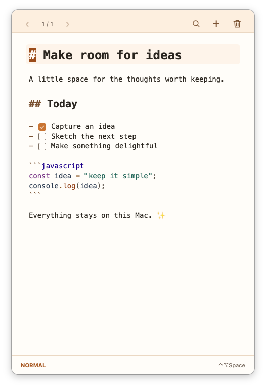
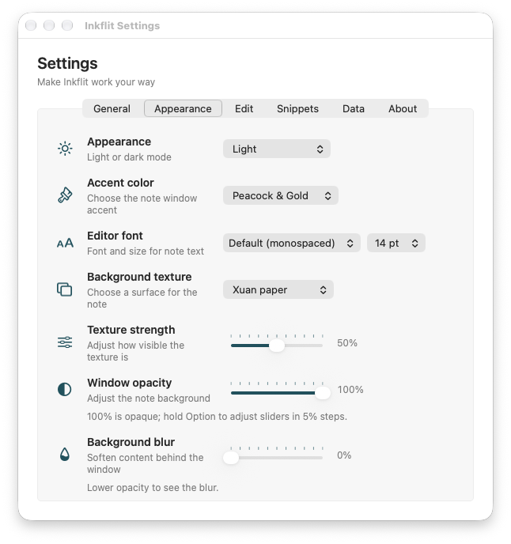

<p align="center"></p>

<h1 align="center">Inkflit</h1>

<p align="center"><strong>A little space for the thoughts worth keeping.</strong><br />Markdown · Vim · Local-first · macOS</p>

<p align="center">English · <a href="README.zh-Hans.md">简体中文</a> · <a href="README.zh-Hant.md">繁體中文</a> · <a href="README.ja.md">日本語</a><br />
<a href="https://inkflit.phpz.org/">Website</a> · <a href="https://github.com/dofy/Inkflit">GitHub</a> · <a href="https://github.com/dofy/Inkflit/issues">Issues</a></p>

<p align="center">
  
  
  
  
  
</p>

A local-first floating note app for macOS, with Markdown, Vim editing, code highlighting, feature blocks and automatic saving.

<p align="center"></p>

<p align="center"></p>

On first launch, Inkflit creates seven guide notes in your system language. Settings → Restore Guide Notes adds a fresh set before your existing notes and opens the welcome note, using the current app language.

The Mac release is built for Apple Silicon. Run `./scripts/package-release.sh` to create an unsigned-for-distribution DMG; the app is ad hoc signed and not notarized.

## Build and run

Requires macOS 13 or later, Xcode Command Line Tools, Node.js and npm.

```sh
npm ci
npm run build
open build/Inkflit.app
```

`npm run test:storage` checks storage recovery; `npm run test:recovery` verifies the recovery notice and restart in an isolated native app.

Install a local build with `./scripts/install.sh` (defaults to `~/Applications/Inkflit.app`), or pass a different absolute `.app` path. The installer refuses to overwrite an existing app.

Run `npm test` for editor tests and `npm run test:native` for isolated native-window, code editing and Vim undo/redo tests. Builds use an ad hoc signature by default; set `INKFLIT_CODESIGN_IDENTITY` to use an Apple Development certificate. The app is not notarized.

Inkflit lives in the menu bar. Press `Control + Option + Space` to show or hide it; it also hides when another app becomes active. Drag the top strip or empty middle of the toolbar to move the window. The default window is portrait 2:3 and can be resized freely. Open Settings from the menu bar or with `⌘,` to configure the shortcut, launch at login, note location, accent, opacity, background blur, code colors and indentation. In Appearance settings, choose Follow System (the default), Light, or Dark. Language follows the system by default; English, Simplified Chinese, Traditional Chinese and Japanese can be selected in Settings. Offline help is available there.

When summoned, the window appears on the display containing the pointer. Inkflit remembers the window's position as a percentage of the available travel range (the display's usable size minus the window size), including after restart. The window size is remembered too. To restore the default size, use **Settings → Appearance → Window size → Reset**. Hold `Option` while adjusting opacity or blur to snap to 5% increments.

## Keyboard shortcuts

| Shortcut | Action |
| --- | --- |
| `⌘N` | New note |
| `⌘[` / `⌘]` | Previous / next note |
| `⌘⇧[` / `⌘⇧]` | First / last note |
| `⌘1`–`⌘9` | Jump to note 1–9 |
| `⌘D` | Delete the current note; restore the latest deletion with `⌘U` within 12 seconds or use Trash in Settings |
| `⌘⇧D` | Delete the current feature block; this can be undone |
| `⌘K` | Change the current block type |
| `⌘L` | Choose a code block language |
| `⌘O` / `⌘⇧O` | Insert an editable line below / above the current text line or feature block |
| `⌘/` | Toggle comments on the current or selected lines |
| `⌘⇧F` | Search all current notes |
| `⌘⇧P` | Open the command palette to search note actions and settings |
| `Esc` | Return to Vim Normal mode. In Normal mode, press twice within 0.6 seconds by default. Turn off **Double Esc to hide** in Editing settings to hide with one press. |

Vim mode is enabled by default. Turn it off in Settings → Editing to type directly; `Esc` then hides the window and `⌘Z` / `⌘⇧Z` undo and redo.

Vim is provided by CodeMirror and `@replit/codemirror-vim`; it is not Neovim and does not load vimrc. Undo history is retained per note while the app runs, but not after exit. Normal mode temporarily switches to an ASCII input source and restores the previous input method in insert mode or when the window loses focus. An active IME candidate is cancelled before Esc leaves insert mode.

The command palette accepts command names and keywords. Use ↑ / ↓ to select, Return to run, and Esc to close. It includes note actions and settings for Vim, interface and code colors, indentation, and language. After a deletion, each notice has its own 12-second timer; `⌘U` restores the highlighted most recently deleted note, or you can click a specific notice.

## Feature blocks

In Vim insert mode, or with Vim turned off, type `/` on an empty line to choose a block. Use arrow keys and Return or click an item. A note may contain multiple independent blocks; use the block header or `⌘K` to change its type, convert it to plain text or delete it. These actions can be undone. Return on the last line adds a line inside the block. Press `⌘O` to add a line below the block.

- **list:** Check items by clicking or typing `/x` at the end of a line; checked items are saved as Markdown `[x]`. Use `Tab` / `Shift-Tab` to indent / outdent by two spaces. The first item stays at the root, an item can be at most one level deeper than its predecessor, and children move with their parent.
- **math:** End an expression with `=` to calculate. Supports arithmetic, percentages, functions, units and per-block variables such as `price: 80`. Variable definitions and subsequent references in expressions are highlighted. Currency conversions use uppercase codes, e.g. `10 USD to CNY =`.
  - Each part of an expression is colored with the code theme.
  - Variable names may use any script, such as `単価: 80`.
  - `min` alone means minutes; `mph` and `nmi` are available.
  - Type `@fn`, `@unit` or `@cur` to insert a function, unit or currency code.
- **sum / avg / count:** Extract and sum or average numbers without evaluating expressions or converting units (for example, `2+3=` counts two numbers); count nonempty items, words and characters. Lines beginning `//` are excluded.
- **code:** Select a language for highlighting. Preview GitHub, Solarized or One Light / One Dark in Settings → Appearance. Choose Follow System, Light, or Dark in the same settings to control Inkflit’s appearance and its code theme. Indent with 2 spaces, 4 spaces or tabs. Brackets and quotes are paired, Return auto-indents, Tab indents and Shift-Tab outdents. `⌘C` copies the block content when nothing is selected.

Blocks use Inkflit text markers such as `:::inkflit math` and `:::end` in the note, rather than code fences. Legacy blocks remain readable. A note whose first line is a block keyword (`list`, `math`, `sum`, `avg`, `count`, or `code` with an optional language such as `code js`) applies it to the whole note and skips the blocks inside it; a whole-note code mode treats everything as code. Exchange rates come from [Frankfurter](https://frankfurter.dev/); requests fetch public rates and do not upload notes. Unavailable rates are not invented.


## Snippets

Type `@` and a word to insert a value. Return inserts the first format; ↑ / ↓ pick another.

- **Built-in words:** `@date`, `@time`, `@now`, `@year`, `@month`, `@day`, `@week`, `@timestamp`, `@uuid`, `@ip`, `@mac`, `@host`.
- **In math blocks:** `@fn` (functions), `@unit` (units), `@cur` (currency codes with today's rate) and `@const` (mathematical and scientific constants). Use `@pi` or `@speedoflight` to find a constant directly.
- **Your own:** add them in Settings → Snippets. Rows sharing a trigger form a group. They are saved in `snippets.json` in the notes folder.
- **Placeholders:** `{date}`, `{date#2}`, an alias such as `{ipv4}`, and `{{` for a literal brace.
- **Caret stops:** `{cursor}` and `{cursor:name}`. Tab / Shift-Tab move between stops and Esc ends them; the stop being filled is highlighted.

Snippets do not appear inside code or right after a letter. The public IP is fetched from ipify only when it is shown or inserted.

## Notes and storage

Notes are stored as individual UTF-8 Markdown files in `~/Documents/Inkflit/notes/`, with an `index.json` for ordering and selection. Feature blocks use Inkflit markers. In Settings, select another folder, configure per-note backup retention (off, a count, or unlimited), restore a backup or deleted note, and rebuild a damaged index from note files. A previous version is saved at most once per note every five minutes while editing. Changing retention does not immediately delete existing versions; the limit is applied when a new version is created. Deleted notes remain in `trash/`; restoring creates a new note and keeps the original. Changing folders copies the complete store and keeps the original. Inkflit does not provide cloud sync; regularly back up the whole store separately. Continuous edits are saved after 0.5 seconds of inactivity, normally at least every 2 seconds while typing. Switching notes, hiding the window, changing storage location or quitting flushes pending changes immediately. Save errors remain visible and a failed save blocks quitting; an unexpected crash can lose unsaved recent edits.

Markdown checkboxes (`[ ]`, `[x]`, `- [ ]`) are clickable in the editor; their source remains Markdown. `//` at the start of a line comments that line. Language-labelled Markdown code fences are highlighted.

## Search and automation

Use the search button, `⌘⇧F` or the menu bar's **Search Notes** item to search current notes. Use the arrow keys and Return to open a result; Esc closes the search. Backups and Trash are excluded.

Inkflit provides a local MCP server over stdio. For Codex, run:

```sh
codex mcp add inkflit -- /Applications/Inkflit.app/Contents/MacOS/Inkflit --mcp
```

Restart the MCP client after configuring it. The tools are `list_notes`, `search_notes`, `get_note`, `get_current_note`, `analyze_note`, `preview_note_format`, `apply_note_format`, `create_note`, `append_note`, `replace_note` and `delete_note`. Supply either `index` (1-based, matching the displayed note number) or the stable `id`; indices change when notes are added or deleted. For `append_note` and `replace_note`, omitting both creates a note. Append adds a separating newline when needed. Deletions go to Trash. Requests use the running app's save and backup pipeline; the server starts Inkflit if necessary.

`list_notes` accepts `limit` (1–100), `cursor`, and `include_content`. Call with `{"limit":20,"include_content":false}` for metadata and short first-line summaries, then pass back `next_cursor` with the same options until it is `null`. With no options, the tool still returns every note with its full text.

`get_current_note` returns the selected note. `analyze_note` accepts `id` or `index` and returns structured math, checklist, sum, average, and count results. Currency calculations use the app’s cached rates.

`preview_note_format` takes a note `id` and returns a unified `diff` and `preview_id` if there are changes. After reviewing the diff, call `apply_note_format` with the same `id` and `preview_id`. Apply uses the previewed edits and rejects the request if the text has changed. Formatting covers supported code blocks and math expressions.

Other MCP clients can use `{"mcpServers":{"inkflit":{"command":"/Applications/Inkflit.app/Contents/MacOS/Inkflit","args":["--mcp"]}}}`. Each write accepts at most 1,000,000 UTF-16 code units of content.

For `create_note`, optionally set `position` to `"first"`, `"last"`, or a 1-based insertion position up to the note count plus one. The default is `"last"`. For example, `{"content":"My note","position":"first"}` puts a new note at the beginning. URL creation also accepts `position=last` or a numeric position.

For Claude Code, run `claude mcp add --transport stdio --scope user inkflit -- /Applications/Inkflit.app/Contents/MacOS/Inkflit --mcp`. In Namo, select Settings → Connections → Add local MCP, enter the same executable and `["--mcp"]` as arguments, then test. Both apps must run as the same user on the same Mac; admitted Namo users can call these tools.

Inkflit also registers `inkflit://note/<action>`, where action is `list`, `get`, `search`, `create`, `append`, `replace` or `delete`. Use percent-encoded query parameters `index` or `id`, `content`, and `query` as applicable. Examples:

```sh
open 'inkflit://note/append?index=2&content=Remember%20milk'
open 'inkflit://note/search?query=milk'
open 'inkflit://note/get?index=1'
```

Without a target, append and replace create a note; get and delete require a target. Without a callback, get opens the note and list/search open the search view. Optional `x-success` and `x-error` parameters accept percent-encoded custom-scheme callback URLs; the callback receives a `result` query parameter containing JSON. HTTP, HTTPS, file and Inkflit callbacks are rejected. Callback JSON is limited to 48 KB. Scheme writes and deletions execute immediately, so only open trusted links.

To open without a callback, use `inkflit://note/open?id=…` (or `?index=2`). `inkflit://settings/appearance` and `inkflit://settings/snippets` open the corresponding settings tabs.
