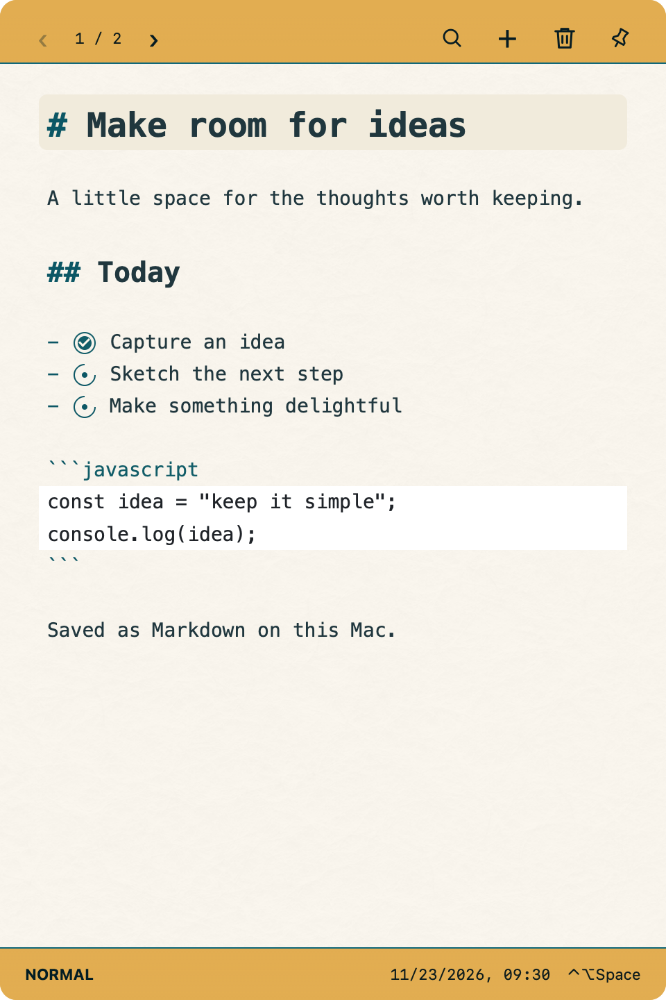
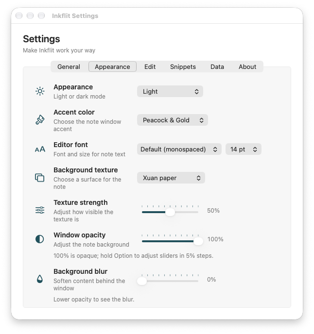

<p align="center"></p>

<h1 align="center">Inkflit</h1>

<p align="center"><strong>给值得记下的想法留一点空间。</strong><br />Markdown · Vim · Local-first · macOS</p>

<p align="center"><a href="README.md">English</a> · 简体中文 · <a href="README.zh-Hant.md">繁體中文</a> · <a href="README.ja.md">日本語</a><br />
<a href="https://inkflit.phpz.org/zh-Hans/">官网</a> · <a href="https://github.com/dofy/Inkflit">GitHub</a> · <a href="https://github.com/dofy/Inkflit/issues">Issues</a></p>

<p align="center">
  
  
  
  
  
</p>

本地优先的 macOS 浮窗笔记：多条笔记、Markdown 编辑、代码高亮、Vim 模式及自动保存。 首次启动时，Inkflit 会按系统语言创建七篇引导笔记。在「设置 → 关于」点击「重新生成引导笔记」，会按当前应用语言把新引导放在已有笔记之前，并打开欢迎页。

<p align="center"></p>

<p align="center"></p>


## 构建和运行

需要 macOS 13 或更新版本、Xcode Command Line Tools、Node.js 和 npm。

```sh
npm ci
npm run build
open build/Inkflit.app
```

`npm run test:storage` 检查存储恢复；`npm run test:recovery` 使用独立原生应用验证恢复提示和重启。

运行 `./scripts/install.sh` 可安装到 `~/Applications/Inkflit.app`，也可传入其他绝对 `.app` 路径。脚本拒绝覆盖已有应用。

运行 `npm test` 检查编辑逻辑；`npm run test:native` 使用独立测试笔记和原生窗口验证代码输入、缩进与 Vim 撤销重做。

应用常驻菜单栏。快捷键默认 `Control + Option + Space`，按一次打开笔记。图钉关闭时，再按一次可收起窗口。点击菜单栏笔记图标，选择“设置…”，或在应用中按 `⌘,`，即可录制、清除或恢复全局快捷键；注册冲突时会显示提示，不覆盖已有快捷键。设置窗口支持 `⌘W` 关闭，并提供离线使用帮助。设置中也可选择登录 Mac 时自动启动；若系统要求授权，请在系统设置中允许。拖动窗口顶部的空白条可以移动浮窗；图钉关闭时，切换到其他应用也会自动收起浮窗。

主窗口默认宽高比为 2:3，也可以自由调整大小。应用默认跟随 macOS 的浅色或深色模式，也可在「设置 → 外观 → 显示模式」中固定为浅色或深色。“设置 → 语言”可选择英语、简体中文、繁体中文或日语，默认跟随系统。在“设置 → 外观”中可选择界面主色、窗口不透明度和背景模糊强度；降低不透明度后可以看到窗口后面的内容。代码高亮配色也可在外观设置中选择和预览。

唤起时，窗口出现在鼠标所在屏幕，并按窗口可移动范围（屏幕可用尺寸减去窗口尺寸）的百分比记住上下左右的相对位置，重启后也会恢复；窗口大小也会记住，可在「设置 → 外观 → 窗口大小」中重置。调整不透明度或背景模糊时，按住 `Option` 可按 5% 一档吸附。

点击工具栏图钉，或在命令面板选择「固定窗口」。固定后，按 `Esc` 或切换应用时窗口保持打开。按 `⌘W` 收起窗口。

在 **设置 → 外观** 可以选择编辑器字体和字号。还可以设置**背景材质**，可选空白、宣纸、羊毛毡、细砂石或粗亚麻。**纹理强度**可以独立于窗口不透明度调整。

翻页时，笔记内容会横向滑动。应用运行期间，每条笔记会保留光标和滚动位置。正文边缘的小箭头提示还有内容在上方或下方。

## 键盘操作

- `⌘N`：新建笔记。
- `⌘[` / `⌘]`：上一条 / 下一条笔记。
- `⌘⇧[` / `⌘⇧]`：第一条 / 最后一条笔记。
- `⌘1`–`⌘9`：跳到第 1–9 条笔记。
- `⌘D`：直接删除当前笔记；12 秒内按 `⌘U` 从最近删除的笔记依次恢复，也可在设置中的回收站恢复。
- `⌘⇧D`：删除光标所在的功能块及其内容，可以撤销。
- `⌘K`：打开当前功能块的类型切换菜单，包括代码块。
- `⌘L`：在代码功能块中打开语言菜单。
- `⌘O` / `⌘⇧O`：在当前正文行或功能块下方 / 上方新建可编辑的普通文本行。
- `⌘/`：切换当前或选中行的注释。普通笔记使用 `//`；代码块使用对应语言的注释语法，未知语言的代码块使用 `//`。
- `⌘↩` 切换当前清单项或 Markdown 任务的完成状态。
- `⌘+` / `⌘-` 将编辑器字号调大 / 调小 1 pt。命令面板也可搜索「加大字号」或「缩小字号」。
- `⌘⇧F`：搜索全部当前笔记。
- `⌘⇧P`：打开命令面板，搜索笔记操作和设置。
- `⌘W`：收起笔记窗口。
- `Esc`：Vim 模式下先退出插入、可视、搜索或待完成命令。图钉关闭时，回到 Normal 后默认连按两次收起窗口。在「设置 → 编辑」关闭「连按两次 Esc 收起窗口」后，按一次即可。

Vim 模式默认开启，可在「设置 → 编辑」关闭。关闭后可直接输入。图钉关闭时，`Esc` 收起窗口。使用 `⌘Z` / `⌘⇧Z` 撤销和重做。

编辑器使用 CodeMirror 和 `@replit/codemirror-vim` 提供 Vim 模拟；它不是 Neovim，也不会读取 vimrc。每条笔记的撤销历史在运行期间保留，退出后不保留。普通模式临时切换到当前的英文键盘布局，插入模式恢复原输入法；隐藏或失焦时也会恢复，避免中文输入法吞掉 Vim 命令。拼音候选未上屏时，Esc 先取消候选，再退出插入模式。完整 Vim 命令及其他第三方输入法仍需进一步验证。

笔记默认分别保存为 `~/Documents/Inkflit/notes/` 中的 UTF-8 Markdown 文件，`index.json` 保存顺序和选中状态，功能块保留 Inkflit 标记。设置中可选择保存位置、设置每篇笔记的备份版本数（关闭、指定数量或无限保留），并恢复历史版本、回收站笔记或重建损坏的索引。编辑时每篇笔记最多每五分钟保存一次旧版本；调整数量不会立即删除已有版本，新版本产生时才按上限清理。删除的笔记保存在 `trash/`，恢复会新建笔记并保留原文件。更换位置会复制整个存储目录并保留原目录。Inkflit 不提供云同步，请定期将整个存储目录备份到其他位置。 连续输入停止约 0.5 秒后保存，持续输入时通常最多约 2 秒保存一次；切换笔记、收起窗口、更改保存位置或退出应用会立即保存。保存失败会显示错误并阻止退出；应用异常崩溃时可能丢失尚未保存的最近修改。

构建默认使用本机临时签名；设置 `INKFLIT_CODESIGN_IDENTITY` 可以指定可用的 Apple 开发者证书。当前未公证。默认全局快捷键已通过真实键盘的隐藏和跨应用唤起测试；同一独占快捷键的冲突提示也已通过隔离实例测试。

命令面板按每条命令最后一次执行的先后排序，最近执行的排在最前。支持按名称或关键词搜索，用 ↑ / ↓ 选择，回车执行，Esc 关闭。面板包含笔记操作，以及 Vim、界面与代码配色、缩进和语言设置。每条删除提示各自倒计时 12 秒；`⌘U` 恢复高亮的最近一条，也可以点击指定提示恢复。

在命令面板输入 `format note`，可以格式化当前笔记中受支持的代码块和数学表达式。完整关键词表见 **设置 → 关于 → 打开使用帮助 → 指令关键词**。

## 功能块

在 Vim 插入模式或关闭 Vim 后，在空行输入 `/` 打开功能菜单，可以继续输入名称筛选，用方向键和回车选择，也可以鼠标点击。支持清单、计算、求和、平均值、计数和代码。每个块只处理自己的内容，同一条笔记可以有多个块。点击块头的类型名称可以修改类型、转为普通文本或删除整个块；这些操作可以撤销。跨块复制只包含可见正文，跨块删除保留块边界。

在功能块末行按回车会在块内新增一行。按 `⌘O` 可在块下方插入空行，再输入 `/` 添加下一个块。代码块在块头选择语言；普通 Markdown 代码围栏仍支持语言高亮。

- `list`：逐行显示复选框；点击或在行末输入 `/x` 切换。勾选结果保存为 Markdown `[x]`。按 `Tab` / `Shift-Tab` 缩进 / 减少缩进，每级两个空格。第一条事项保持根级，事项最多比前一条深一级，调整父事项时子事项一起移动。
- `math`：在表达式末尾输入 `=`，支持基本运算、百分比、常见数学函数、单位换算和变量（例如 `price: 80`）。变量定义及后续算式中的引用会高亮。结果仅显示，不写入正文；各块变量互不影响。大写三字母货币代码可换算，例如 `10 USD to CNY =`。
  - 算式的各个部分按代码配色分别着色。
  - 变量名可以用中文等任何文字，例如 `单价: 80`。
  - 单独写 `min` 表示分钟；支持 `mph` 和 `nmi`。
  - 输入 `@fn`、`@unit` 或 `@cur` 插入函数、单位或货币代码。
- `sum` / `avg`：提取并汇总块内数字，不计算算式或转换单位。例如 `2+3=` 会统计两个数字。`count` 显示非空项目、词和字符数。`//` 行不计入统计。
- `code`：选择语言后高亮。“设置 → 外观 → 代码配色”可预览 GitHub、Solarized 或 One Light / One Dark，在同一页的「显示模式」里可选跟随系统、浅色或深色，代码配色也会一起切换。编辑时自动配对括号和引号，回车根据上下文缩进；在匹配的括号之间回车会创建缩进的中间行。`Tab` 插入缩进，`⇧Tab` 减少缩进，可在设置中选择 2 个空格、4 个空格或 Tab。光标在代码块内且没有选中文本时，`⌘C` 复制块内代码（不含边界标记）；选中文本时照常复制选区。保留原始缩进。

功能块保存在笔记正文中，使用 Inkflit 自有的文本标记（例如 `:::inkflit math` 与 `:::end`），编辑器显示为块头与边界，而不是代码围栏。旧版本的功能围栏和首行关键词仍可读取；首行写 `list`、`math`、`sum`、`avg`、`count` 或 `code`（可带语言，例如 `code js`）时，整篇笔记按该类型处理，笔记里的其他块不参与；整篇代码笔记里的一切都当作代码。货币汇率由 [Frankfurter](https://frankfurter.dev/) 提供，按服务返回日期显示；请求只获取公开汇率，不上传笔记。离线或服务不可用时不显示伪造汇率。

## 片段

输入 `@` 加一个词插入常用值。回车插入第一种格式，↑ / ↓ 选择其他格式。

- **内置词：**`@date`、`@time`、`@now`、`@year`、`@month`、`@day`、`@week`、`@timestamp`、`@uuid`、`@ip`、`@mac`、`@host`。
- **计算块里：**`@fn`（函数）、`@unit`（单位）、`@cur`（货币代码，附当日汇率）、`@const`（数学和科学常量）。输入 `@pi` 或 `@speedoflight` 可以直接查找常量。
- **自定义：**在「设置 → 片段」添加。同一触发词的几行组成一组。保存在笔记文件夹的 `snippets.json`。
- 在 **设置 → 片段 → 片段开关** 可以按组或逐项启停片段。
- **占位符：**`{date}`、`{date#2}`、`{ipv4}` 这样的别名，`{{` 表示字面的 `{`。
- **光标位置：**`{cursor}` 和 `{cursor:姓名}`。`Tab` / `Shift-Tab` 在位置间跳转，`Esc` 结束跳转；正在填的位置会突出显示。

代码里、或紧跟在字母后面时不弹出片段。公网 IP 只在显示或插入时向 ipify 查询。

## 搜索与自动化

点击顶部搜索按钮、按 `⌘⇧F`，或从菜单栏选择“搜索笔记”，可搜索全部当前笔记；方向键选择，回车打开，Esc 关闭。搜索不包含备份和回收站。

Inkflit 提供本机 stdio MCP 服务。Codex 可运行：

```sh
codex mcp add inkflit -- /Applications/Inkflit.app/Contents/MacOS/Inkflit --mcp
```

配置后重启 MCP 客户端。可用工具为 `list_notes`、`search_notes`、`get_note`、`get_current_note`、`analyze_note`、`preview_note_format`、`apply_note_format`、`create_note`、`append_note`、`replace_note` 和 `delete_note`。通过 `index`（从 1 开始，与页面编号一致）或稳定的 `id` 指定笔记；新增、删除后编号会变化。追加和覆盖不指定目标时会新建；追加时需要的话自动补换行。删除进入回收站。所有请求经运行中的应用执行保存和备份；应用未运行时服务会尝试启动它。

`list_notes` 支持 `limit`（1–100）、`cursor` 和 `include_content`。用 `{"limit":20,"include_content":false}` 分页获取基本信息和首行摘要，再带上返回的 `next_cursor` 及同样的选项继续读取，直到游标为 `null`。省略所有选项时仍返回全部笔记正文。

`get_current_note` 读取当前选中的笔记。`analyze_note` 按 `id` 或 `index` 返回数学、清单、求和、平均值和计数的结构化结果。货币换算使用应用缓存的汇率。

`preview_note_format` 按笔记 `id` 生成格式化预览。有改动时返回统一格式的 `diff` 和 `preview_id`。查看差异后，把同一个 `id` 和 `preview_id` 传给 `apply_note_format`。如果正文已变化，需要重新预览。格式化仅处理支持的代码块和数学表达式。

其他 MCP 客户端可使用 `{"mcpServers":{"inkflit":{"command":"/Applications/Inkflit.app/Contents/MacOS/Inkflit","args":["--mcp"]}}}`。单次写入内容最多 1,000,000 个 UTF-16 代码单元。

新建笔记时，`create_note` 的可选 `position` 可设为 `"first"`、`"last"` 或从 1 开始的插入序号（最大为当前笔记数加 1）；默认 `"last"`。例如 `{"content":"我的笔记","position":"first"}` 在最前面新建。URL 新建也支持 `position=first` 或数字位置。

Claude Code 可运行 `claude mcp add --transport stdio --scope user inkflit -- /Applications/Inkflit.app/Contents/MacOS/Inkflit --mcp`。在 Namo 的连接设置中添加本地 MCP，填写相同的可执行文件及参数 `["--mcp"]`，保存后测试。Namo 和 Inkflit 需在同一台 Mac 以同一用户运行；所有获准对话的成员都能调用这些工具。

应用也注册了 `inkflit://note/<action>`，操作包括 `list`、`get`、`search`、`create`、`append`、`replace`、`delete`。按需提供经过 URL 编码的 `index` 或 `id`、`content`、`query` 参数，例如：

```sh
open 'inkflit://note/append?index=2&content=Remember%20milk'
open 'inkflit://note/search?query=milk'
open 'inkflit://note/get?index=1'
```

追加和覆盖不指定目标时新建，读取和删除必须指定目标。未指定回调时，读取会打开笔记，列表和搜索会打开搜索界面。可选 `x-success` / `x-error` 参数接受 URL 编码的自定义 scheme 回调地址，回调的 `result` 参数包含 JSON；不接受 HTTP、HTTPS、file 或 Inkflit 回调，JSON 最大 48 KB。scheme 写入和删除会立即执行，只应打开可信链接。

使用 `inkflit://note/open?id=…`（或 `?index=2`）直接打开笔记。`inkflit://settings/appearance` 和 `inkflit://settings/snippets` 分别打开外观和片段设置。
