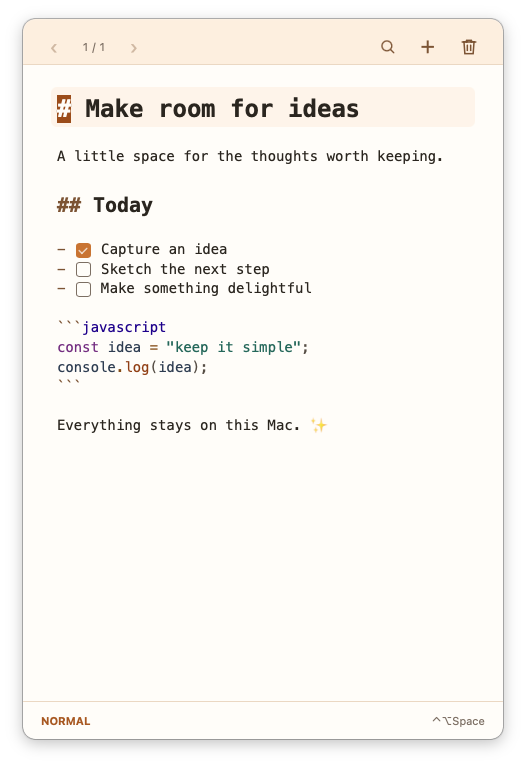
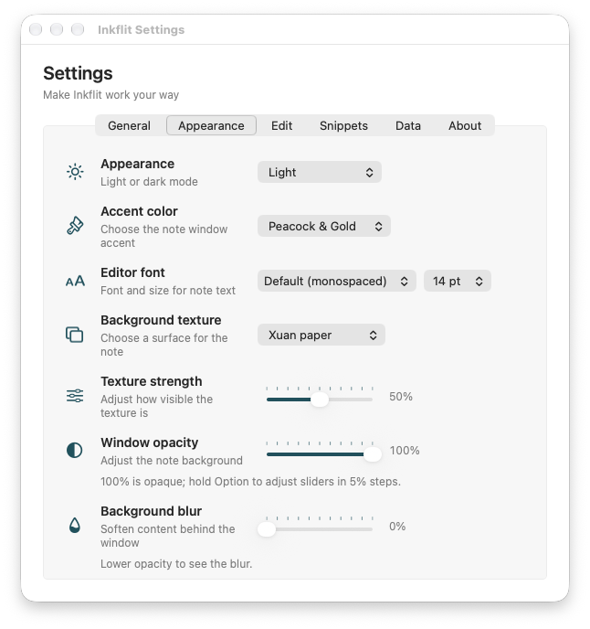

<p align="center"></p>

<h1 align="center">Inkflit</h1>

<p align="center"><strong>為值得記下的想法留一點空間。</strong><br />Markdown · Vim · Local-first · macOS</p>

<p align="center"><a href="README.md">English</a> · <a href="README.zh-Hans.md">简体中文</a> · 繁體中文 · <a href="README.ja.md">日本語</a><br />
<a href="https://inkflit.phpz.org/zh-Hant/">官網</a> · <a href="https://github.com/dofy/Inkflit">GitHub</a> · <a href="https://github.com/dofy/Inkflit/issues">Issues</a></p>

<p align="center">
  
  
  
  
  
</p>

Inkflit 是本地優先的 macOS 浮動筆記，支援多則筆記、Markdown、Vim 編輯、程式碼突顯、功能區塊與自動儲存。 首次啟動時，Inkflit 會依系統語言建立七篇引導筆記。在設定中點擊「重新產生引導筆記」，會依目前應用程式語言把新引導放在已有筆記之前，並開啟歡迎頁。

<p align="center"></p>

<p align="center"></p>


## 建置與執行

需要 macOS 13 以上、Xcode Command Line Tools、Node.js 與 npm。

```sh
npm ci
npm run build
open build/Inkflit.app
```

`npm run test:storage` 檢查儲存復原；`npm run test:recovery` 使用獨立原生應用程式驗證復原提示和重新啟動。

執行 `./scripts/install.sh` 可安裝到 `~/Applications/Inkflit.app`，也可傳入其他絕對 `.app` 路徑。腳本拒絕覆寫既有應用程式。

`npm test` 測試編輯邏輯；`npm run test:native` 使用獨立筆記測試原生視窗、程式碼編輯與 Vim 復原。預設使用臨時簽章，可透過 `INKFLIT_CODESIGN_IDENTITY` 指定 Apple 開發者憑證；目前未經公證。

應用程式常駐選單列，按 `Control + Option + Space` 顯示或收起筆記，切換至其他應用程式時自動收起。拖曳視窗頂部或工具列中央空白處可移動視窗。預設寬高比為 2:3，可自由調整大小。選單列或 `⌘,` 可開啟設定，調整快捷鍵、登入時啟動、儲存位置、主色、不透明度、背景模糊、程式碼配色與縮排；介面自動配合 macOS 淺色／深色模式。語言預設跟隨系統，也可選英語、簡體中文、繁體中文或日語。設定內附離線使用說明。

喚起時，視窗會出現在滑鼠所在螢幕，並以視窗可移動範圍（螢幕可用尺寸減去視窗尺寸）的百分比記住上下左右的相對位置，重新啟動後也會還原；視窗大小也會記住，可在「設定 → 外觀 → 視窗大小」中重設。調整不透明度或背景模糊時，按住 `Option` 可吸附至每 5% 一格。

## 快捷鍵

| 快捷鍵 | 功能 |
| --- | --- |
| `⌘N` | 新增筆記 |
| `⌘[` / `⌘]` | 上一則／下一則筆記 |
| `⌘⇧[` / `⌘⇧]` | 第一則／最後一則筆記 |
| `⌘1`–`⌘9` | 跳到第 1–9 則筆記 |
| `⌘D` | 直接刪除筆記；12 秒內按 `⌘U` 由最近刪除的筆記依序復原，也可從設定的回收站還原 |
| `⌘⇧D` | 刪除目前功能區塊；可復原 |
| `⌘K` | 切換目前區塊類型 |
| `⌘L` | 選擇程式碼區塊語言 |
| `⌘O` / `⌘⇧O` | 在目前正文行或功能區塊下方／上方新增可編輯的文字行 |
| `⌘/` | 切換目前或選取行的註解 |
| `⌘⇧F` | 搜尋所有目前筆記 |
| `⌘⇧P` | 開啟命令面板，搜尋筆記操作與設定 |
| `Esc` | 先回到 Vim 一般模式。一般模式下預設在 0.6 秒內連按兩次收起視窗。可在「設定 → 編輯」關閉「連按兩次 Esc 收起視窗」，改用單次按鍵。 |

Vim 模式預設開啟，可在「設定 → 編輯」關閉。關閉後可直接輸入，`Esc` 收起視窗，使用 `⌘Z` / `⌘⇧Z` 復原和重做。

Vim 由 CodeMirror 和 `@replit/codemirror-vim` 提供，並非 Neovim，也不讀取 vimrc。每則筆記的復原歷史僅在執行期間保留。普通模式會暫時切換英文鍵盤，插入模式或視窗失焦時恢復原輸入法；輸入法候選未確認時，Esc 先取消候選。

命令面板支援按名稱或關鍵字搜尋；用 ↑ / ↓ 選擇、Return 執行、Esc 關閉。面板包含筆記操作，以及 Vim、介面與程式碼配色、縮排和語言設定。每條刪除提示各自倒數 12 秒；`⌘U` 復原高亮的最近一條，也可以點擊指定提示復原。

## 功能區塊

在 Vim 插入模式或關閉 Vim 後，於空行輸入 `/`，以方向鍵、Return 或滑鼠選擇。每則筆記可包含多個獨立區塊；點擊區塊標題或按 `⌘K` 可切換類型、轉為純文字或刪除，這些操作可以復原。在非程式碼區塊的最後空行再按 Return 可離開區塊。

- **list**：點擊或在行末輸入 `/x` 勾選，結果儲存為 Markdown `[x]`。按 `Tab` / `Shift-Tab` 縮排 / 減少縮排，每級兩個空格。第一項保持根層級，項目最多比前一項深一級，調整父項目時子項目一起移動。
- **math**：算式以 `=` 結尾，支援運算、百分比、函數、單位換算與區塊內變數，例如 `price: 80`。變數定義與後續算式中的引用會突顯。貨幣換算使用大寫代碼，例如 `10 USD to CNY =`。
  - 算式的各個部分依程式碼配色分別著色。
  - 變數名稱可以用中文等任何文字，例如 `單價: 80`。
  - 單獨寫 `min` 表示分鐘；支援 `mph` 和 `nmi`。
  - 輸入 `@fn`、`@unit` 或 `@cur` 插入函式、單位或貨幣代碼。
- **sum / avg / count**：擷取數字加總或平均，不計算算式或換算單位（例如 `2+3=` 包含兩個數字）；也可統計非空項目、詞與字元；忽略 `//` 註解行。
- **code**：選擇語言突顯程式碼。可在設定的外觀頁預覽 GitHub、Solarized 或 One Light / One Dark，同一頁的「顯示模式」可選跟隨系統、淺色或深色，程式碼配色會一起切換。可選 2 空格、4 空格或 Tab 縮排。括號與引號自動配對，Return 自動縮排，Tab 縮排、Shift-Tab 減少縮排。無選區時 `⌘C` 複製區塊內容。

區塊以 `:::inkflit math`、`:::end` 等 Inkflit 標記儲存在正文，不是程式碼圍欄；舊格式仍可讀取；第一行寫 `list`、`math`、`sum`、`avg`、`count` 或 `code`（可帶語言，例如 `code js`）時，整篇筆記依該類型處理，筆記中的其他區塊不參與；整篇程式碼筆記中的一切都當作程式碼。匯率由 [Frankfurter](https://frankfurter.dev/) 提供，只取得公開匯率，不上傳筆記；服務無法使用時不會虛構匯率。


## 片段

輸入 `@` 加一個詞插入常用值。Return 插入第一種格式，↑／↓ 選擇其他格式。

- **內建詞：**`@date`、`@time`、`@now`、`@year`、`@month`、`@day`、`@week`、`@timestamp`、`@uuid`、`@ip`、`@mac`、`@host`。
- **計算區塊中：**`@fn`（函式）、`@unit`（單位）、`@cur`（貨幣代碼，附當日匯率）、`@const`（數學和科學常數）。輸入 `@pi` 或 `@speedoflight` 即可直接查找常數。
- **自訂：**在「設定 → 片段」新增。同一觸發詞的幾行組成一組。儲存在筆記資料夾的 `snippets.json`。
- **預留位置：**`{date}`、`{date#2}`、`{ipv4}` 這樣的別名，`{{` 表示字面的 `{`。
- **游標位置：**`{cursor}` 和 `{cursor:姓名}`。`Tab`／`Shift-Tab` 在位置間跳轉，`Esc` 結束跳轉；正在填的位置會突出顯示。

程式碼裡、或緊接在字母後面時不彈出片段。公用 IP 只在顯示或插入時向 ipify 查詢。

## 筆記與儲存

筆記預設分別儲存在 `~/Documents/Inkflit/notes/` 的 UTF-8 Markdown 檔案中，`index.json` 記錄順序與選取狀態。設定可指定位置、備份版本數（關閉、指定數量或無限保留），並還原歷史版本或回收站筆記，以及重建損壞的索引。編輯時每則筆記最多每五分鐘備份一次舊版本；調整數量不會立即刪除既有版本，而是在新版本建立時套用上限。刪除的筆記保留在 `trash/`，還原會建立新筆記並保留原檔。變更位置會複製整個儲存目錄並保留原檔。Inkflit 不提供雲端同步，請定期將整個目錄備份到其他位置。 連續輸入停止約 0.5 秒後儲存，持續輸入時通常最多約 2 秒儲存一次；切換筆記、收起視窗、更改儲存位置或退出應用程式會立即儲存。儲存失敗時會顯示錯誤並阻止退出；應用程式異常崩潰時可能遺失尚未儲存的最近修改。

Markdown 核取方塊（`[ ]`、`[x]`、`- [ ]`）可在編輯器點擊，原始內容仍為 Markdown。行首 `//` 為註解；標明語言的 Markdown 程式碼圍欄會突顯語法。

## 搜尋與自動化

點擊頂部搜尋按鈕、按 `⌘⇧F` 或從選單列選擇「搜尋筆記」，可搜尋所有目前筆記；方向鍵選擇，Return 開啟，Esc 關閉。搜尋不包含備份及回收站。

Inkflit 提供本機 stdio MCP 服務。Codex 可執行：

```sh
codex mcp add inkflit -- /Applications/Inkflit.app/Contents/MacOS/Inkflit --mcp
```

設定後重新啟動 MCP 用戶端。工具包括 `list_notes`、`search_notes`、`get_note`、`get_current_note`、`analyze_note`、`preview_note_format`、`apply_note_format`、`create_note`、`append_note`、`replace_note` 和 `delete_note`。使用從 1 開始、與畫面一致的 `index` 或穩定的 `id` 指定筆記；增刪筆記後編號會變化。追加及覆寫未指定目標時會新增筆記，追加時會按需要加入換行；刪除進入回收站。操作經由應用程式儲存並備份，必要時服務會啟動 Inkflit。

`list_notes` 支援 `limit`（1–100）、`cursor` 和 `include_content`。用 `{"limit":20,"include_content":false}` 分頁取得基本資料和首行摘要，再帶上傳回的 `next_cursor` 和原有選項繼續讀取，直到游標為 `null`。省略所有選項時仍會傳回所有筆記全文。

`get_current_note` 讀取目前選取的筆記。`analyze_note` 依 `id` 或 `index` 傳回數學、清單、加總、平均值與計數的結構化結果。貨幣換算使用應用程式快取的匯率。

`preview_note_format` 依筆記的 `id` 產生格式化預覽。有變更時會傳回統一格式的 `diff` 和 `preview_id`。檢視差異後，把同一個 `id` 和 `preview_id` 傳給 `apply_note_format`。若正文已變更，需要重新預覽。格式化只處理支援的程式碼區塊和數學運算式。

其他 MCP 用戶端可使用 `{"mcpServers":{"inkflit":{"command":"/Applications/Inkflit.app/Contents/MacOS/Inkflit","args":["--mcp"]}}}`。每次寫入最多 1,000,000 個 UTF-16 程式碼單元。

新增筆記時，`create_note` 的選用 `position` 可設為 `"first"`、`"last"` 或從 1 開始的插入位置（最大為目前筆記數加 1）；預設 `"last"`。例如 `{"content":"我的筆記","position":"first"}` 在最前面新增。URL 新增也支援 `position=first` 或數字位置。

Claude Code 可執行 `claude mcp add --transport stdio --scope user inkflit -- /Applications/Inkflit.app/Contents/MacOS/Inkflit --mcp`。在 Namo 的連線設定中新增本機 MCP，填入相同的執行檔與參數 `["--mcp"]`，儲存並測試。兩者須在同一台 Mac 以同一使用者執行；獲准對話的成員都能使用這些工具。

應用程式也支援 `inkflit://note/<action>`，操作為 `list`、`get`、`search`、`create`、`append`、`replace` 或 `delete`。依需求提供 URL 編碼的 `index` 或 `id`、`content`、`query`：

```sh
open 'inkflit://note/append?index=2&content=Remember%20milk'
open 'inkflit://note/search?query=milk'
open 'inkflit://note/get?index=1'
```

追加及覆寫未指定目標時會新增；讀取及刪除必須指定目標。沒有回呼時，讀取會開啟筆記，列表與搜尋會開啟搜尋畫面。選用的 `x-success` / `x-error` 可指定 URL 編碼的自訂 scheme 回呼，`result` 參數包含 JSON；不接受 HTTP、HTTPS、file 或 Inkflit 回呼，JSON 上限為 48 KB。scheme 寫入及刪除會立即執行，請只開啟可信連結。

用 `inkflit://note/open?id=…`（或 `?index=2`）直接開啟筆記。`inkflit://settings/appearance` 和 `inkflit://settings/snippets` 分別開啟外觀和片段設定。
